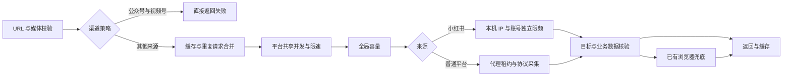

# 采集执行流程

更新：2026-11-07（微信渠道停用策略已发布）。逐来源字段、文件和评论限制集中在 [平台清单](PLATFORM_SUPPORT.md)，不再维护第二份不同版本的平台表。

## 一次业务请求

1. API 校验 URL、媒体名、页码；`registry.py` 和 `source_catalog.py` 校验域名并提取目标 ID。
2. `EngagementService` 对微信公众号、视频号直接返回失败；其他来源检查缓存/合并相同在途请求。缓存键包含操作、平台、URL、页码和不透明评论 cursor；同页不同 cursor 不再串页。
3. 等待平台熔断冷却、取得共享平台槽位、完成该操作的限速，再取得全局采集槽位。等待限速不占用全局容量。
4. `EngagementCrawler` 根据注册处理器执行协议。一次业务内部复用代理租约；临时错误可重试，确定删除/无权限等状态停止重试。普通平台无代理时不转服务器直连。
5. 校验业务状态、目标 ID/线程、字段来源、评论层级和翻页进度；协议不可用且该平台有既存浏览器实现时才进入 Camoufox。
6. 互动与评论分别返回、分别缓存。评论全量模式按游标遍历、去重、识别阻断；不获取楼中楼正文。

## 批任务

`BatchJobManager` 按真实上游分组建立有界 worker 队列，各组并行推进；共享执行信号量继续约束每个任务的实际并发。小红书排队不再占满普通平台 worker。每条记录取得平台/全局/任务槽位后才开始执行超时，排队时长仍计入结果的总耗时。

结果按完成顺序持久化，调用方使用 `item_id` 对照输入。取消、服务重启恢复、任务总时限、幂等和结果 cursor 机制保持不变。MongoDB 的 `job_requests` 保存原始条目；没有原始输入的老任务不能自动补造输入。

## 共享上游与账号

- 新浪多个来源共用 `sina`；财富号、股吧、基金/Choice/哈富等共用 `eastmoney`。
- 搜狐号/搜狐网、网易号/网易视频、汽车之家/车家号、凤凰网/大风号分别共享同组容量。
- 不同名称不会倍增同一出版方的并发。配置冲突时共享并发取较小值、限速间隔取较大值。
- 小红书使用既有真实账号、本机出口 IP 和独立限速，不进入代理池；底层每次上游请求也受账号串行与间隔控制。不能仅限制 API 调用次数而忽略一次调用的多个详情/分页请求。
- 腾讯新闻 `i.news.qq.com` 的代理 CONNECT 403 已实测可通过同一代理连接解析后的公网 IP 恢复。只对已验证域名/CONNECT 403 生效，保留 URL、Host、TLS SNI 和证书校验；不用于上游业务 403。

## 业务验收规则

- 请求与响应必须归属于目标作品；推荐区、账号累计量和关联作品字段不能代替目标互动。
- 未公开或无法确认的字段为 `null`；只有平台明确提供零值或有效目标讨论接口确认零评论时才返回 `0`。
- 评论仅采一级正文，回复保留数量。文章总评论数、一级评论总数、当前页条数分别核对，不能互相推算替代。
- 分页有后续标记却没有数据或 cursor 不前进时必须报异常；登录跳转、空 HTML、业务失败和 HTTP 200 空包不表示末页。
- 关闭评论、仅作者可见、删除和缺授权状态如实返回；不可把 SSR 中仅管理者可见的正文暴露给匿名调用方。
- 单次样本成功不代表该平台所有内容成功；签名离线对拍不代表服务器已经接受协议。

请求与响应格式见 [API](API.md)、[评论 IO](COMMENTS_API_IO.md)。

## 新增采集器的位置

扩展来源的名称、域名在 `source_catalog.py`，按既有协议复用对应模块；新协议放 `app/crawlers/platforms/`。`extended_publishers.py` 只分派处理器和统一错误，不堆页面解析。当前新增模块和全部旧模块均可从平台清单直达。

调试材料留在 `.local/analysis/<case>/`。稳定结论更新对应文档，阶段报告和重复导出件保留本地；当前能力表只保留一份。实际任务逻辑在 `services/`，不新增第二套后台框架。
